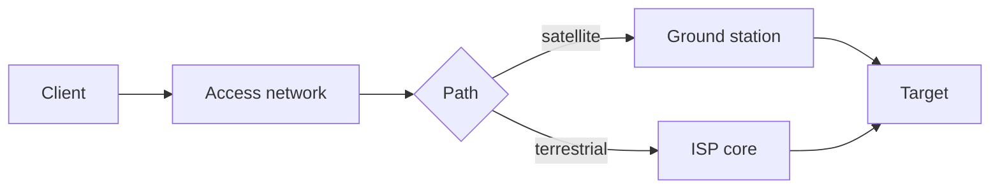

This page is a **draft** and is never published. It exists only to check how content renders.
Run `npm run dev:drafts` and open it locally to preview any change to the design system.

## Text and lists

Regular paragraph with **bold**, *italic*, `inline code`, and a [link to the Labs page](/labs/).

- Unordered item
- Another item
  - Nested item

1. Ordered item
2. Second item

> A blockquote for definitions or quotes from RFCs.

## Code blocks

A fenced block with a title (`title="..."` after the language):

```python title="collect.py"
import subprocess

def ping(host: str, count: int = 5) -> str:
    """Run ping and return raw output."""
    return subprocess.run(["ping", "-c", str(count), host], capture_output=True, text=True).stdout
```

Configuration file:

```yaml title="topology.clab.yml"
name: example
topology:
  nodes:
    r1: { kind: linux, image: frrouting/frr:latest }
    r2: { kind: linux, image: frrouting/frr:latest }
  links:
    - endpoints: ["r1:eth1", "r2:eth1"]
```

CLI output uses the `console` language and renders as a terminal:

```console title="r1 — vtysh"
r1# show ip route
Codes: K - kernel route, C - connected, S - static, O - OSPF, B - BGP
C>* 10.0.12.0/30 is directly connected, eth1
```

## Tables

| Field | Meaning | Example |
|---|---|---|
| `title` | Post title | Understanding BGP |
| `category` | Must match a category in `src/config/taxonomy.ts` | Routing & Switching |
| `draft` | Hide from the public site | `true` |

## Math (LaTeX)

Inline math such as $\text{BDP} = C \times \text{RTT}$, and display math:

$$
\text{Throughput} \le \frac{\text{MSS}}{\text{RTT}} \cdot \frac{C}{\sqrt{p}}
$$

## Mermaid diagrams



## Images

<Figure src="/favicon.svg" alt="Site icon used as a placeholder image" caption="Figure 1. Images live in public/images or public/diagrams." width={160} />

## Callouts

<Callout type="note">Use callouts for context the reader should not miss.</Callout>

<Callout type="warning" title="Caution">Configuration changes in production should be staged and verified.</Callout>

## Downloadable files

<Download href="/datasets/examples/plotly-example.json" label="Example figure file" meta="JSON" description="Files under public/ can be offered for download." />

## Interactive charts (Plotly)

The example below plots a synthetic mathematical function — it is **not** measurement data.

<PlotlyChart src="/datasets/examples/plotly-example.json" title="Example figure (synthetic function)" caption="Rendered from a Plotly JSON figure in public/datasets/." height={320} />

## References

Footnotes create a reference list automatically.[^1]

[^1]: J. Postel, “Internet Protocol,” RFC 791, 1981.
